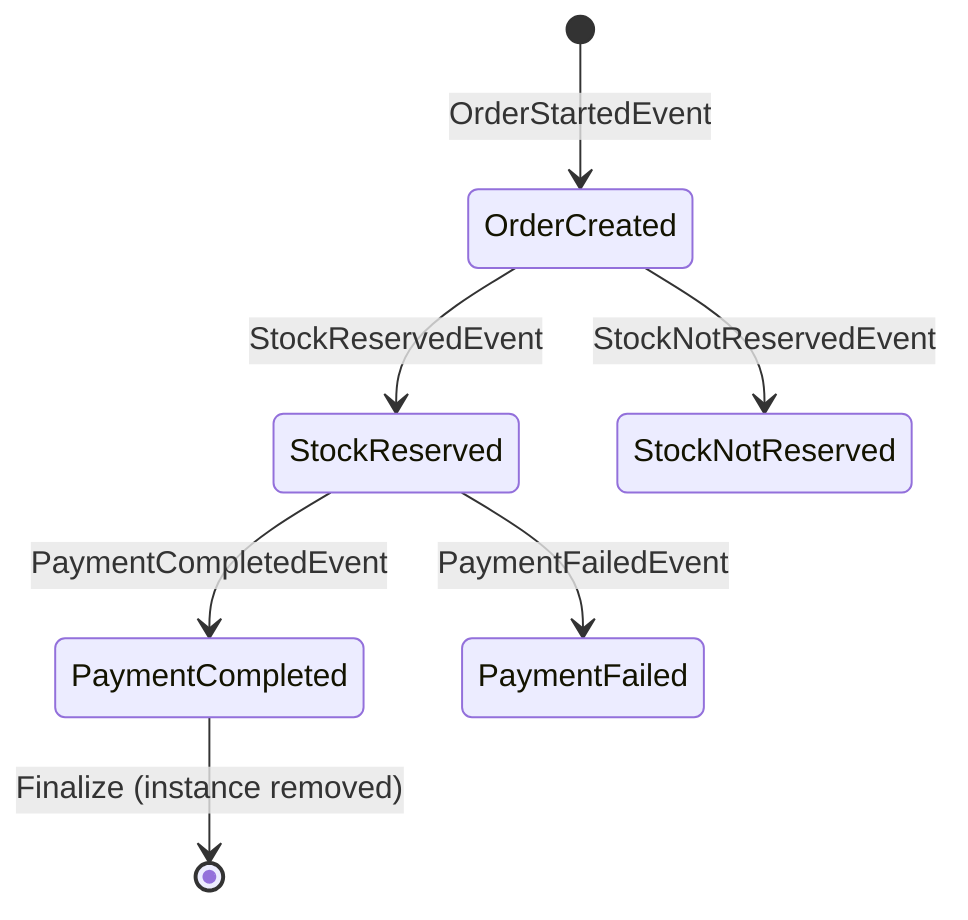
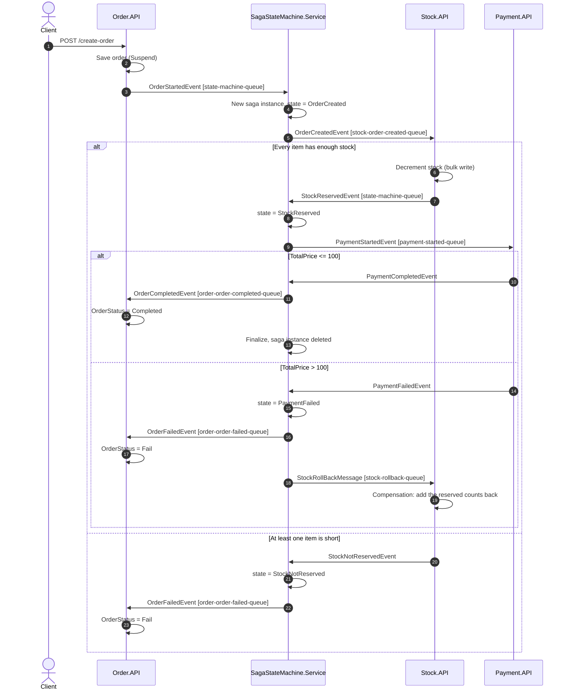

# Saga Orchestration with MassTransit

A .NET 10 sample that coordinates a distributed order workflow across Order, Stock and Payment services with an orchestration-based saga (MassTransit state machine, RabbitMQ, SQL Server, MongoDB).


## Overview

Placing an order touches three services that each own their data: the order, the stock levels and the payment. A single ACID transaction across them isn't possible, so the workflow runs as a **saga**: a series of local transactions, where a failure later in the chain triggers **compensating actions** for the steps that already succeeded.

This repository uses the **orchestration** style. A dedicated `SagaStateMachine.Service` holds the workflow state and tells each participant what to do next. The participants never talk to each other. They only receive commands from the orchestrator and report back to it.

- The orchestrator is a MassTransit `MassTransitStateMachine<OrderStateInstance>`.
- Saga instances are persisted in SQL Server through the MassTransit Entity Framework Core saga repository.
- Every message is **sent** to a specific queue (`ISendEndpointProvider` / `.Send(...)`) rather than published, so routing is explicit. Queue names live in `Shared/Settings/RabbitMQSettings.cs`.

## Architecture

### Services

| Service | Type | Storage | Responsibility |
|---|---|---|---|
| `Order.API` | ASP.NET Core minimal API | SQL Server (`OrchestrationOrderDB`) | Creates the order in `Suspend` state, starts the saga, and sets the final status (`Completed` / `Fail`). |
| `SagaStateMachine.Service` | Worker (generic host) | SQL Server (`OrchestrationSagaDB`) | The orchestrator: correlates events, tracks state and sends the next command. |
| `Stock.API` | ASP.NET Core (consumers only) | MongoDB (`SagaOrchestrationDB`) | Reserves stock and handles the stock rollback (compensation). Seeds products 21 to 25 on startup. |
| `Payment.API` | ASP.NET Core (consumers only) | none | Simulated payment: succeeds when `TotalPrice <= 100`, otherwise fails. |
| `Shared` | Class library | none | Events, messages and queue name constants. |

### State machine



### Message flow

Every arrow between the orchestrator and a service is a point-to-point send to the named RabbitMQ queue.



## Tech stack

- .NET 10 (ASP.NET Core minimal APIs and a Worker Service)
- MassTransit 8.5 (Apache-2.0) with the RabbitMQ transport and the Entity Framework Core saga repository
- Entity Framework Core 10 with SQL Server (orders and saga state)
- MongoDB.Driver 3 (stock)
- Swagger / Swashbuckle (enabled in the Development environment)
- Central package management: TFM and shared build settings in `Directory.Build.props`, package versions in `Directory.Packages.props`

## Project structure

```text
SagaOrchestration.sln
Directory.Build.props                 # Target framework (net10.0) and shared build settings
Directory.Packages.props              # Central NuGet package versions
global.json                           # .NET 10 SDK
docker-compose.yml                    # RabbitMQ, SQL Server, MongoDB for local development
src/services/
├── Order.API/
│   ├── Consumers/                    # OrderCompletedEventConsumer, OrderFailedEventConsumer
│   ├── Contexts/ApplicationDbContext.cs
│   ├── Entities/, Enums/, Models/
│   ├── Services/IOrderService.cs     # Persists the order and sends OrderStartedEvent
│   └── Program.cs                    # POST /create-order
├── SagaStateMachine.Service/
│   ├── OrderStateMachine.cs          # States, events, transitions
│   ├── OrderStateInstance.cs         # Persisted saga state
│   ├── OrderStateMap.cs, OrderStateDbContext.cs
│   └── SagaConfiguration.cs          # MassTransit + EF Core saga repository setup
├── Stock.API/
│   ├── Consumers/                    # OrderCreatedEventConsumer, StockRollbackMessageConsumer
│   ├── DataInitializer.cs            # Seeds products 21 to 25
│   └── MongoDbService.cs
├── Payment.API/
│   └── Consumers/PaymentStartedEventConsumer.cs
└── Shared/
    ├── Events/, Messages/
    └── Settings/RabbitMQSettings.cs  # Queue names
```

## Getting started

### Prerequisites

- [.NET 10 SDK](https://dotnet.microsoft.com/download)
- Docker (for RabbitMQ, SQL Server and MongoDB)

### 1. Start the infrastructure

```bash
docker compose up -d
```

| Component | Address | Credentials |
|---|---|---|
| RabbitMQ (AMQP) | `localhost:5672` | `guest` / `guest` |
| RabbitMQ management UI | http://localhost:15672 | `guest` / `guest` |
| SQL Server | `localhost,1433` | `sa` / `Your_password123` |
| MongoDB | `mongodb://localhost:27017` | none |

These are **local development defaults only**. They match the `ConnectionStrings` and `MongoDB` sections in each service's `appsettings.json`. If you change them, update both places, or override them with environment variables such as `ConnectionStrings__ConnectionString`.

> The SQL Server image is `linux/amd64`. On Apple Silicon it runs through Docker Desktop's Rosetta emulation.
>
> SQL Server needs about 20 to 30 seconds after `docker compose up` before it accepts logins. If `Order.API` or `SagaStateMachine.Service` exits on startup with a "pre-login handshake" error, wait a moment and start it again.

### 2. Run the services

Start each service in its own terminal. The databases are created automatically on startup (`EnsureCreated`), and Stock.API seeds its collection when it is empty.

```bash
dotnet run --project src/services/SagaStateMachine.Service
dotnet run --project src/services/Stock.API   --launch-profile http   # http://localhost:5204
dotnet run --project src/services/Payment.API --launch-profile http   # http://localhost:5050
dotnet run --project src/services/Order.API   --launch-profile http   # http://localhost:5052/swagger
```

### 3. Send requests

Seeded stock: product `21` = 200, `22` = 100, `23` = 50, `24` = 10, `25` = 30.

**Happy path.** The total is 50, so payment succeeds and the order ends up `Completed`:

```bash
curl -X POST http://localhost:5052/create-order \
  -H "Content-Type: application/json" \
  -d '{ "buyerId": 1, "orderItems": [ { "productId": 21, "count": 2, "price": 25 } ] }'
```

**Payment failure with compensation.** The total is 150, so payment fails, the order is marked `Fail` and the reserved stock for product 22 is restored:

```bash
curl -X POST http://localhost:5052/create-order \
  -H "Content-Type: application/json" \
  -d '{ "buyerId": 1, "orderItems": [ { "productId": 22, "count": 3, "price": 50 } ] }'
```

**Stock failure.** Product 24 only has 10 units, so the order is marked `Fail` and nothing is reserved:

```bash
curl -X POST http://localhost:5052/create-order \
  -H "Content-Type: application/json" \
  -d '{ "buyerId": 1, "orderItems": [ { "productId": 24, "count": 50, "price": 1 } ] }'
```

The same requests are in `src/services/Order.API/Order.API.http`. The endpoint returns `200 OK` as soon as the order is stored and the saga has started. The final outcome is reflected asynchronously in `Orders.OrderStatus` (`0` = Suspend, `1` = Completed, `2` = Fail) and in the saga table `OrderStateInstance`.

## Design notes and trade-offs

- **Orchestration vs. choreography.** All workflow logic lives in one place (`OrderStateMachine`), which makes the flow easy to read, change and observe. The cost is an extra service, and every participant depends on the orchestrator's queue.
- **Point-to-point sends instead of publish/subscribe.** Each step targets an explicit queue. This keeps the routing visible in code, but the sender has to know the receiver's queue name.
- **Correlation.** `OrderStartedEvent` is correlated by `OrderId`, and the saga assigns a new `CorrelationId` (`SelectId(_ => Guid.NewGuid())`). Every later message carries that `CorrelationId` (`CorrelatedBy<Guid>`).
- **Persistent saga state.** The EF Core saga repository stores `CurrentState`, `OrderId`, `BuyerId`, `TotalPrice` and `CreatedDate`. Completed sagas are removed (`SetCompletedWhenFinalized`). Failed ones remain in `PaymentFailed` or `StockNotReserved` and can be inspected.
- **Compensation.** Only the stock reservation needs undoing. The orchestrator sends `StockRollBackMessage` with the order items carried along in the payment messages.
- **Schema creation.** The services call `Database.EnsureCreated()` on startup to keep the demo self-contained. There are no EF Core migrations.

## Known limitations

This is a learning sample, not production code:

- **No transactional outbox.** `Order.API` saves the order and then sends `OrderStartedEvent` as two separate operations. If the send fails, the order stays in `Suspend` with no saga.
- **No idempotency or retry policy.** MassTransit's default error/skipped queues apply, and redelivered messages are not deduplicated.
- **Stock reservation isn't atomic.** Availability is checked first and decremented afterwards, so concurrent orders can oversell. The rollback consumer uses read-modify-replace.
- **Payment is simulated.** The only rule is `TotalPrice <= 100`.
- **Failed saga instances are never finalized**, and there are no timeouts for participants that don't respond.
- No authentication, input validation, health checks or automated tests.
